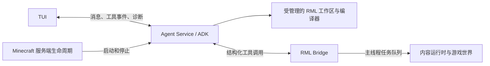

# ResourceModLoader 2.0：Agent Native 内容运行时计划

状态：本文包含 2.0 目标设计与当前工程入口。现已拆出无外部依赖的 `runtime/`、独立 `compiler/` 和文件来源层，并接入函数、数据规则、玩法、世界生成、展示、时钟及世界测试模块。可重载定义与启动期原生注册的边界见第 14 节；后续生命周期、多人同步及 Agent 完整体验仍按阶段门槛验收。

启动期模块已拆入 `rml.loader.module`，通过构造参数接收 `ModuleLoader`；`LoaderRuntime` 负责装配，Forge 事件与 ASM 钩子只负责路由。当前仍保留资源包的启动期 Forge 容器，以承接现有资源加载；配置、原生注册和外部脚本集成保持启动期语义。函数模块的命令与 Java API 迁移见[函数文档](modules/FUNCTIONS/README.md)和[开发接口](java/ResourceModLoader/README.md)。

## 1. 目标与当前判断

让玩家用自然语言提出玩法，让 Agent 把想法变成可组合、可执行、可验证、可持续修改的 RML 内容。玩家能够在游戏中体验结果，并继续提出修改。

2.0 按核心架构重建规划。当前缺陷多、内容能力少，缺乏动态加载与热插拔；现有实现用于盘点行为、收集回归案例和迁移内容，不作为新运行时的成熟基础。

三个目标分别有自己的工程条件：

| 目标 | 必须具备的条件 | 判断是否达成 |
| --- | --- | --- |
| 容易发生 | 自动发现环境、少量必要澄清、可运行起点、短反馈周期 | 玩家不编辑配置或安装开发工具，也能从一句想法进入预览并继续修改 |
| 容易拆分 | 稳定标识、显式依赖、能力与状态契约、局部验收 | 一个玩法单元可以独立构建、验证、替换和复用，影响范围可以计算 |
| 图灵完备 | 通用脚本、条件、循环、函数、可增长的数据结构 | 能表达通用计算，并能通过受控 API 影响游戏；不依赖穷举动作类型 |

“任何想法”是产品方向。实际可实现范围受已安装能力、Minecraft 生命周期和资源限制约束。无法满足时必须指出缺失能力，并形成具体的原生扩展任务；不能把降低玩法要求当作成功。

首个平台建议固定为当前的 Minecraft 1.12.2 / Forge。先证明完整闭环，再评估其他平台；新核心与 Forge 类型隔离。

## 2. 重构前代码揭示的边界

以下记录首轮重构前的架构观察，作为迁移依据，不是当前实现状态或完整 bug 清单：

| 当前实现 | 对 2.0 的约束 |
| --- | --- |
| [RMLModDiscover](https://github.com/Ecdcaeb/ResourceModLoader/blob/main/src/main/java/rml/loader/core/RMLModDiscover.java) 在启动注入时把资源包包装为 Forge ModContainer | 新的动态内容包必须有独立生命周期，不能依赖运行中重新执行 Forge 启动流程 |
| [ResourceModLoader](https://github.com/Ecdcaeb/ResourceModLoader/blob/main/src/main/java/rml/loader/ResourceModLoader.java) 用全局静态集合维护启用容器 | 核心必须有明确的实例边界、活动版本和可释放的资源归属 |
| [FunctionExecutorGameLoop](https://github.com/Ecdcaeb/ResourceModLoader/blob/main/src/main/java/rml/loader/deserialize/function/executor/FunctionExecutorGameLoop.java) 在构造时注册事件监听器 | 解析和校验不得改变游戏；激活时才创建监听器，并登记卸载句柄 |
| [ContainerHolder](https://github.com/Ecdcaeb/ResourceModLoader/blob/main/src/main/java/rml/loader/api/mods/ContainerHolder.java) 的加载上下文主要负责文件读取，以及抛出或记录错误 | 增加结构化诊断、依赖校验和激活结果，不能只靠日志判断成功 |
| [RMKKubeJs](https://github.com/Ecdcaeb/ResourceModLoader/blob/main/src/main/java/rml/layer/compat/kubejs/RMKKubeJs.java) 通过反射直接接入外部脚本管理器 | 保留脚本内容的迁移价值；外部管理器的全局状态不能成为新核心的生命周期契约 |
| [modules.json](https://github.com/Ecdcaeb/ResourceModLoader/blob/main/src/main/resources/META-INF/rml/modules.json) 描述模块类型和默认路径 | 可沿用命名空间习惯；类型目录还必须描述版本、输入输出、运行阶段和动态能力 |

稳定性工作分两条线：1.x 处理影响现有用户的崩溃、内容丢失和错误加载；2.0 以真实缺陷建立行为案例，验证新契约。不要先无限修补 1.x，再开始证明新内核。

## 3. 玩家与 Agent 的完整流程

1. 玩家提出想法。Agent 读取当前游戏版本、已安装模组、可用能力和已有内容，给出简短的玩法描述与预期体验。
2. Agent 把想法转换为一组可观察的行为。例如触发条件、游戏反馈、状态变化和失败条件。只澄清会改变核心玩法或产生不可逆影响的歧义，其余使用可修改的默认值。
3. Agent 建立内容依赖图，先完成一个可以玩的最小完整场景，再扩展细节。每个单元记录其输入、输出、拥有的状态与验收方式。
4. 构建候选版本，执行静态检查和场景验证。缺少能力、引用错误或需要重启时，返回明确结果。
5. 在隔离的预览世界加载候选版本；Agent 读取事件轨迹、状态断言和游戏画面，玩家直接体验。
6. 玩家提出修改。Agent 根据依赖图修改受影响的单元，验证后替换活动版本；失败时保留原版本。
7. 将已经验证的相同构建产物应用到目标世界，或导出可安装内容包。正常游戏执行不需要模型在线。

实现工具应从第一个运行时里程碑就参与验证。Agent 层随着内核一起生长，不能等所有内容能力完成以后再接入。

## 4. 核心架构与责任

| 边界 | 负责什么 | 不应承担什么 |
| --- | --- | --- |
| `rml-core` | 内容定义、依赖图、版本切换、资源归属、状态契约、诊断 | Forge 对象、模型调用、纹理和世界实现 |
| `rml-forge112` | 游戏事件桥接、游戏线程提交、原生载体、存档和客户端同步 | 推测玩家意图、直接管理脚本全局变量 |
| `rml-script` | 主脚本引擎、独立上下文、执行预算、受控游戏 API | 任意反射进入 Minecraft、私自注册全局监听器 |
| 能力提供者 | 实现具体事件、查询、动作和内容类型，并声明契约 | 绕过核心的资源归属和激活流程 |
| `rml-tooling` | 环境查询、构建校验、预览、应用、场景运行和结果读取 | 再维护一份独立的内容格式或加载逻辑 |
| Agent 接入 | 理解想法、拆任务、编辑内容、调用工具、解释结果 | 成为游戏逐 tick 执行的必要依赖 |

这些首先是代码责任边界，不要求拆成六个部署单元或引入分布式服务。能力提供者可以由 Forge 适配层内置，也可以由启动时安装的原生模组提供。

RML 以一个稳定的 Forge 模组接入游戏；RML 内容包是其管理的运行时对象。内容包有自己的列表、版本、依赖与诊断，展示不依赖动态创建 Forge ModContainer。

核心不变量：

- 解析、依赖解析、类型检查和候选构建不产生游戏副作用。
- 每个监听器、任务、脚本上下文、缓存和资源句柄，都归属于一个内容包的特定代次。
- 游戏主线程只在明确的边界切换活动版本；事件派发固定顺序，新旧代次不能同时处理同一事件。
- 必需单元失败时整个候选拒绝激活。可选能力必须显式声明，降级结果必须可见。
- 游戏执行热路径使用预先解析和绑定的调用；不逐 tick 读取 JSON、扫描目录、查反射或重建依赖图。

## 5. 内容格式、可拆分性与能力发现

沿用命名空间标识，如 `moon:ritual`。包负责版本、环境约束和依赖；单元是最小的组合、替换和验收对象；文件只是单元的源码载体。

一个单元的最小契约：

| 字段 | 含义 |
| --- | --- |
| `id` / `kind` | 稳定标识与内容类型 |
| `requires` | 依赖的单元、能力及版本约束 |
| `exports` | 向其他单元提供的函数、事件或类型化值 |
| `config` | 可由玩家或其他单元配置的参数及类型 |
| `state` | 状态所属范围、结构版本与迁移规则；无状态时明确声明 |
| `checks` | 可观察的验收场景或引用 |

装载依赖是有向无环图；计算出的固定顺序可重复，循环依赖直接报告路径。运行时的递归和事件循环由脚本与调度器承担，不混入装载依赖。

调用者只能经公开契约访问其他单元。禁止依赖对方文件路径、私有状态和装载顺序。多个内容包写同一配方或规则时，必须显式声明覆盖关系；未声明的冲突是构建错误。

能力目录由实际注册的提供者生成，与校验器和脚本 API 共用同一份定义。每项能力至少包含：

- 稳定 ID、提供者与版本、参数和结果类型、可运行示例。
- 适用端、线程、调用阶段以及是否会改变世界。
- 支持首次动态加载、替换或卸载中的哪些操作，以及具体限制。
- 资源释放、执行预算、状态持久化和客户端同步要求。

现有反序列化器可用于盘点字段，不能直接等同于完整 schema：自定义解码行为仍须补充明确约束。

初期使用普通文件、JSON Schema 和生成的脚本 API 声明。保留现有原生资源格式，脚本直接使用通用语言；不另造通用可视化编程语言或多层编译中间表示。

## 6. 动态加载、热替换与卸载

分别定义三种操作：运行中首次装入新内容、替换活动内容、卸载活动内容。文件变化只会触发候选构建，不直接修改活动状态。

候选版本在提交前完成：格式和能力校验、依赖影响分析、脚本编译、资源准备、状态迁移检查。运行时以“包 ID + 代次”管理其资源。

替换步骤：

1. 解析受影响的依赖闭包，固定当前活动版本和状态修订号，准备候选。
2. 在游戏线程边界暂停该闭包的事件派发与任务；使已启动异步任务的旧代次结果失效。
3. 对最新状态取得一致性快照，在副本执行迁移并验证。迁移失败则恢复旧版本派发。
4. 提交新的路由、定义与状态视图；提交过程不执行用户脚本或不可逆游戏操作。
5. 新事件只进入新代次，释放旧监听器、任务、上下文和资源。旧代次后到的异步结果不得写入新状态。

候选可见前失败，保留旧版本。清理失败必须报告并阻止该包继续热替换，不能累计残留资源。原生提供者若没有可回收或可补偿的激活机制，就不能声明支持热插拔。

普通事件处理已经造成的世界变化，不属于内容版本切换的事务。切回代码版本不会自动收回物品、复活实体或恢复地形。无损试错依赖预览世界；目标世界的破坏性变更需要单独的操作计划与备份。

卸载前计算反向依赖；存在活动依赖者时拒绝，或将显式选择的依赖闭包一起停用。卸载后不再产生新逻辑副作用，引用中的数据如何保留由下一节约束。

## 7. Minecraft 注册限制与动态内容路线

1.12.2 Forge 的原生注册生命周期与 RML 的逻辑内容生命周期分开。不能把“再扫一次文件”和“强行解冻注册表”作为通用动态加载方案。

| 内容类型 | 建议路线 | 必须声明的边界 |
| --- | --- | --- |
| 事件规则、定时任务、脚本行为 | RML 管理路由与任务所有权 | 支持装入、替换、卸载；旧代次不得继续执行 |
| 资源与表现定义 | RML 管理资源索引、模型缓存失效和客户端准备 | 必须实际完成客户端重载，不能只更新服务端定义 |
| 战利品与配方规则 | 通过受控提供者在查询或执行入口应用逻辑定义 | 逐项验证原生兼容、配方浏览器展示和缓存更新；不能笼统承诺全可热更 |
| 动态物品 | 启动时注册稳定原生载体，运行时用逻辑 ID 与 NBT 标识具体内容 | 不保证其他模组把不同逻辑物品识别为不同 Forge 注册项 |
| 动态方块 | 预注册有限载体类别，按方块位置保存逻辑 ID 和状态 | 碰撞、光照、渲染、区块存储和方块实体逐项验收，不能只做一个通用方块类就宣称完成 |
| 实体行为 | 先支持已有实体的行为扩展，再扩展预注册实体载体 | 新原生实体类、网络协议或特殊渲染可能仍需安装提供者并重启 |
| 新 Java 类、ASM、原生注册类型与新维度类型 | 由原生能力提供者在启动时安装 | 返回 `requires_restart`，不伪装成动态内容能力 |

定义删除时，背包、区块与实体里可能仍保存逻辑 ID。默认保留可序列化的失活记录和原数据，停止行为，呈现明确的缺失内容状态；重新安装相容定义后可恢复。不能为了“卸载成功”静默删除玩家资产，也不能要求先扫描所有未加载区块。

有三种不同结果：逻辑停用、释放运行资源、从存档永久删除。前两者是热卸载职责，第三者是独立数据迁移操作。

多人游戏以服务端为权威。包版本、能力版本和资源清单参与握手；客户端准备候选资源完成后才参与切换。无法支持此次动态变化的客户端按协议保持旧版本并使切换失败，或按事先声明的策略断开；不得在同一会话中混用不同内容代次。

## 8. 图灵完备与可控制的执行

当前创作语言采用增强数据包：目录、命名空间、标签、JSON 定义和 `.mcfunction` 源码，经独立 `compiler/` 编译为 RML 内容协议。通用计算由函数调用、条件、返回值、持久 NBT storage 和跨 tick 调度组合；核心 `runtime/` 不依赖 Minecraft，原生解码与执行由 Forge 适配层提供。现有外部脚本继续作为独立集成，不作为新内容语言的必要依赖。

现有 KubeJS、CraftTweaker、GroovyScript 内容可用于迁移研究，其直接 Java 访问和外部生命周期不能自动获得新运行时的热卸载或隔离保证。

语言必须表达条件、递归、可增长的数据结构和显式持久状态。耗时计算通过调度与序列化状态跨 tick 推进；更换代码不迁移任意调用栈。数值提供者、谓词、物品效果和其他原生表达式使用统一 `DeserializerManager` 嵌套解码，扩展命名构造器可以参与已有组合。

图灵完备描述语言在抽象无限资源条件下的表达能力。实际运行设置每次执行的指令预算、状态容量和宿主调用额度；跨 tick 的计算可以持续推进，不承诺有限机器可以执行无限计算。

必须证明：无限循环可中止且游戏继续推进；递归耗尽和宿主调用异常可归因到所属单元；单元异常不会悄悄跳过验收。主线程不能通过“外部超时线程”安全终止任意 JVM 脚本，因此不能把超时等待当作执行中断方案。

原生 API 也必须有成本边界，不能让一个宿主调用无界扫描世界。默认不暴露文件、网络、进程和反射能力。这里提供运行时稳定性边界；同一 JVM 内的引擎和原生提供者不应被宣传为可运行任意恶意代码的安全沙箱。

验收除游戏玩法外，使用通用计算案例验证语言能力，例如两计数器机器及跨 tick 执行的结果一致性。一个有限案例不能单独证明图灵完备，表达能力依据所选语言语义判断。

## 9. 状态、客户端同步与可观察性

状态按世界、维度、玩家、实体和内容包分域，使用稳定标识与明确的结构版本。服务端状态不依赖客户端表现，跨单元访问遵循公开契约。

首次装入、热替换、世界保存、退出重进、内容缺失后重装，都必须保持定义明确的数据语义。破坏结构的变更必须有迁移函数；没有迁移则拒绝替换。只把显式状态写入存档，不保存活的 Minecraft 对象引用。

诊断贯穿源码到游戏事件，至少能定位包、单元、代次、文件位置或 JSON 路径、阶段与错误代码。给 Agent 返回结构化结果，并提供面向玩家的简短解释。

事件轨迹默认限制容量并按需开启，记录触发、条件、动作和状态变化的因果链。不能为可观察性在每 tick 复制整个世界或保存无界日志。

初始工具协议只围绕稳定的运行时操作：

| 操作 | 输入与输出 |
| --- | --- |
| `inspect` | 返回环境、能力、活动内容与版本，以及可用场景 |
| `check` | 校验源码与依赖，输出诊断、影响闭包和重启要求；不执行世界变更 |
| `preview` | 在预览世界激活指定构建产物，返回会话与版本 |
| `scenario` | 指定会话、场景、随机种子与固定 tick，返回断言、状态差异、轨迹；需要时取得画面 |
| `apply` | 使用已经校验的产物及期望活动版本执行提交，返回实际结果；版本过期则拒绝 |
| `deactivate` | 停用指定内容或显式依赖闭包，返回引用保留和清理结果 |

CLI 与 Agent 工具共用这些操作及序列化结果。MCP 可以作为薄适配层，不能另外实现加载器。任何模型或编辑器都可以操作本地工程；运行时不绑定模型厂商。

## 10. 首个完整玩法与拆分示例

玩家想法：夜间手持月石右击祭坛，消耗一颗月石并召唤守卫；击败守卫获得奖励；每位玩家每夜只能成功一次。

| 单元 | 输入与输出 | 验收 |
| --- | --- | --- |
| `moon:moonstone` | 提供动态物品逻辑 ID、图标和说明 | 运行中首次加入，物品可获取、可保存，客户端正确显示 |
| `moon:altar` | 识别指定原版方块上的交互，输出祭坛位置与玩家 | 非祭坛不触发，客户端与服务端不会重复提交 |
| `moon:ritual` | 组合夜间判定、月石消耗、召唤与每夜资格状态 | 同玩家同夜成功一次；召唤失败时不消耗材料或占用资格 |
| `moon:guardian` | 为已有原生实体设置身份与行为，输出有效击败事件 | 普通同类实体不计入；死亡事件不重复结算 |
| `moon:reward` | 根据击败事件向归属玩家发放奖励 | 多人同时参与时奖励归属正确，无重复发放 |
| `moon:ritual_checks` | 固定环境、时间、玩家和随机种子 | 白天、缺材料、重复交互、退出重进、双玩家与卸载路径全部满足约定 |

每个单元可以包含数据和脚本；不为每个文件创建单元。初始祭坛与守卫复用原生载体，动态新方块作为独立能力增加，不影响这一玩法先形成完整闭环。

多单元协作通过明确事件与结果契约。例如召唤动作必须返回成功与实体 ID；材料和资格更新由一次受控游戏操作提交，处理失败补偿，不假设普通脚本的几行语句天然具有事务性。

## 11. 分阶段交付与门槛

按可观察结果推进，不按“把大架构写完”推进。每阶段产出都必须能在实际游戏运行。

| 阶段 | 交付内容 | 进入下一阶段的门槛 |
| --- | --- | --- |
| P0：锁定契约与高风险原型 | 从现有缺陷整理场景；确定包/单元/能力/状态/资源归属契约；验证事件生命周期、动态物品载体、脚本中断三个原型 | 实际游戏中完成首次装入→触发→替换→停用；无限循环可被中断；证明新逻辑物品可同步和存取。任一关键假设失败就修订设计 |
| P1：可释放的运行内核 | 依赖解析、候选校验、代次、主线程切换、监听器/任务归属；工具提供最小 inspect/check/apply/deactivate | 连续 100 次装入/替换/卸载，活动监听器与任务恢复基线，无重复触发；错误候选不影响旧版本；对资源残留执行断言 |
| P2：脚本与持久状态 | 主脚本引擎、稳定游戏 API、执行预算、分域状态、迁移、结构化诊断和场景运行 | 通用计算和跨 tick 任务通过；状态在重进游戏后保留；迁移失败、旧异步结果、任务取消均有正确结果 |
| P3：可组合的内容能力 | 动态物品、交互、实体行为、奖励和资源同步；实现完整月石祭坛玩法 | 正常、失败、多人、替换、缺失内容和重装场景通过；客户端表现与服务端状态一致 |
| P4：Agent 完整构建体验 | 实际能力目录、类型与示例、工程起点、预览和画面反馈、局部修改与导出 | 使用实际 Agent 从自然语言开始完成构建、游戏验证、一次需求修改和再次验证，全程不手工修正生成文件 |
| P5：扩大能力与正式迁移 | 动态方块、更多原生桥接；1.x 内容迁移器和迁移报告 | 每个新增内容类型通过同一生命周期/存档/同步契约；代表性旧包在迁移后行为等价，无法转换的内容逐项报告 |

P0 的原型可以是一次性验证工程；不能把未通过契约的原型积累成正式核心。P1 起，Agent 使用现有工具参与构建和检查；P4 验收的是完整玩家体验。

P5 覆盖的扩展能力属于正式 2.0 计划，不以单个演示玩法宣布全部完成。需要调整范围时显式修订计划和验收表。

## 12. 缺陷治理、验证与迁移

已知问题按可观察失败归档：加载/依赖、生命周期泄漏、脚本执行、数据与存档、客户端同步、外部模组兼容。优先级首先考虑崩溃、资产损坏、重复副作用和无法定位的错误。

验证层次：

- 纯核心验证：依赖冲突、确定性顺序、状态迁移、资源归属与提交失败；不启动 Minecraft。
- 提供者契约验证：装入、替换、卸载、失败清理、线程约束和预算，不允许每个集成自定义另一套生命周期。
- 游戏场景验证：真实游戏中的交互、持久化、多人同步和资源表现。视觉结果必须由实际画面验证，日志通过不足以代替。

对真实缺陷建立最小回归；正常功能主要由可复用场景证明。固定种子、tick、环境清单与输入序列，记录构建指纹，确保 Agent 与维护者可以重现同一结果。

性能门槛使用固定游戏环境测量和公布：tick 开销、激活停顿、客户端资源重载、内存与句柄数量。P0 先取得基线再设置预算，本文不虚构毫秒数。

迁移建议：

1. 新包使用明确的新格式版本，并独立记录运行时 API、能力和状态版本，避免把不同兼容性塞进同一个 `pack_version`。
2. 提供显式转换器，将 1.x 模块与路径转换为新包；输出保留、转换、需要重写的逐项报告。
3. 可直接保留的原版资源继续使用原格式；脚本必须迁移到新能力 API 才能获得新生命周期保证。
4. 旧版内容在受支持的 1.x 发行线上继续使用；2.0 不隐式按多个旧语义解释同一份包，不长期维护两套活动内核。
5. 存档采用独立版本迁移和备份，不能把源码转换成功等同于世界数据迁移成功。

## 13. 本计划建议先确定的决策

- 2.0 建立独立内容运行时，Forge 只承载稳定接入。
- 热插拔依靠资源归属、代次与状态契约；“已重新读文件”不能作为完成标准。
- 通用计算使用单一主脚本语言，静态内容复用数据格式，能力缺口由明确的原生提供者补齐。
- 动态原生载体与需要重启的能力分别报告，不承诺所有 Minecraft 注册项任意热更。
- 用一个完整玩法贯穿架构、工具、Agent 和游戏验证，并以失败路径验收稳定性。
- 下一步工程产物是 P0 的三项可运行原型和契约初稿；先验证最可能推翻设计的假设，再冻结正式 API。

## 14. 增强数据包的当前工程入口

`compiler/` 是独立 Java 8 工具；输入为目录或 ZIP，入口为 `pack.mcmeta` 中的 `rml` 元数据和 `data/<namespace>/<registry>/...`。编译产物包含 `rml.info`、带类型与源码位置的 `rml:content` 定义、源码映射和原样复制的客户端资源。

```text
gradlew.bat -p compiler check executableJar
java -jar compiler/build/libs/rml-compiler.jar capabilities
java -jar compiler/build/libs/rml-compiler.jar check dev/datapack-example
java -jar compiler/build/libs/rml-compiler.jar compile dev/datapack-example build/rml-agent-example.zip
```

目标目录以 Minecraft 26.3 官方数据导出的 60 个可定义注册表为依据，另包含函数、NBT 结构模板、标签，以及 RML 的 `item`、`block`、`machine_recipe` 扩展；执行平台固定为 1.12.2 Forge。注册表覆盖不等于对新版本所有 JSON 字段、原生行为和高度范围的逐字兼容。功能通过可组合的 RML 定义表达，每项数据经对应的原生提供者验证和执行，缺失字段、类型和引用必须给出诊断。

`LoaderRuntime` 装配 `DataRules`、`GameplayModule`、`WorldgenModule`、`PresentationModule` 和 `TimeTestModule`；模块在 `registerDecoders(manager)` 注册组合类型。物品、方块、附魔及展示载体先声明原生注册壳，依赖注册项的子节点在注册完成后解析；世界生成在生物群系注册事件中初始化。`FunctionModule` 管理可重新加载的函数、标签、数值提供者、战利品、谓词、修饰器和结构模板。配方、附魔、维度、生物群系、原生载体及其他启动期定义需要重新启动游戏；函数命令不等同于完整 Forge 模组热重载。

通用解析支持 `Type`、嵌套 List/Map/Set/Optional/泛型数组、泛型 `@Record` 构造器，以及范围、权重表、空间值、方块状态、NBT 和匹配器。原生模块在相同注册表中提供自己的数值、条件、效果、世界生成、展示、时间和测试类型。实现方式与示例见[解码开发接口](java/deserializer/README.md)。

内置物品修饰器的 `count` 和 `damage` 字段可嵌套带 `type` 的数值提供者，并保留外层 `conditions`。例如 `{"function":"minecraft:set_count","count":{"type":"minecraft:uniform","min":2,"max":2}}` 会在原生执行时计算数量；具名谓词与修饰器也在执行时解析，保持它们与活动内容代次一致。

`set_damage.damage` 表示剩余耐久比例，`1` 为完整耐久，`0` 为耗尽；数值节点与原版静态修饰器使用相同含义。

`damage_type.scaling` 使用原版枚举 `never`、`always`、`when_caused_by_living_non_player` 控制难度缩放；可组合的数值倍率使用独立的 `damage_multiplier` 字段。`exhaustion` 交给原生伤害来源按命中计算，避免在事件回调中重复施加。

时钟配置、时间线进度与命名空间函数 storage 使用原生 `MapStorage` 持久化。磁盘往返契约通过真实保存目录和新的存储实例恢复状态，覆盖 Minecraft 的反射构造入口。

增强 `data` 命令接受 SNBT 标量、带引号的字符串、列表、类型化数组及复合标签，并保留原生 NBT 类型。`load` / `tick` 标签监听器按 RML 的 Forge 归属注册，监听器本身仍由内容代次负责释放。

`execute if/unless score` 的比较、`matches` 范围和 `store ... score` 支持虚拟计分名称及实体选择器；非玩家实体沿用原生 UUID 计分标识。

`dev/datapack-example/` 演示 load 标签、增强 execute、命令 storage、具名谓词、物品修饰器、战利品、数值提供者、伤害类型、时钟、时间线和世界测试。示例时钟从 0 开始驱动主世界时间，适合独立预览世界。安装编译后的 ZIP 后，可以运行：

```text
/function rml_agent_example:reward
/function rml_agent_example:modify_held
/rml loot give @s loot rml_agent_example:reward
/rml clock query rml_agent_example:main
/rml test run rml_agent_example:gold_block 0 80 0
/rml capabilities
/rml capabilities decoders
```

`modify_held` 将手中物品数量设为 2；世界测试临时放置金块并在结束时恢复受影响的方块和方块实体。编译器与解码契约、完整 Forge 构建、实际世界行为和客户端画面分别验证，不用其中一项代替其他项。

此前的 1.12.2 客户端场景验证了函数返回值 `42` 与宏参数、storage/实体/谓词条件、虚拟计分比较及结果写入、具名修饰器数量与名称、数值节点耐久效果、原生伤害缩放、熔炉产物、平坦维度层、三倍时钟、世界测试后的方块恢复，以及服务端对话通过网络显示。原生世界存档另以真实磁盘往返契约验证；这些场景不代表对新版本每个字段和每种内容组合的穷尽测试。

当前 P1 工具入口为 `/rml tools inspect|check|apply|deactivate`，以及同一实现的 `ResourceModLoader.runtime().getTools()`。响应统一为 JSON，包含会话、运行时版本、活动代次和结构化诊断。`check` 保留已解析候选，`apply` 使用候选标识与预期版本提交；`deactivate` 同时核对会话与版本。已编译启动期定义变化报告 `requires_restart`。命令、候选有效期及依赖要求见[函数工具协议](modules/FUNCTIONS/README.md#agent-运行工具)。

运行工具已在独立客户端通过真实命令管理器验收：校验后改写源文件仍提交原候选；旧版本、被替换候选和错误会话均被拒绝；解析失败保留旧函数行为；启动期定义修改及删除报告重启要求。连续 100 次停用与重新提交后，验证包的归属资源数保持为 3，运行时版本递增到 204。验收加载完整模组 JAR，不依赖额外的 `runtime.jar`。

### 可组合能力与实际执行入口

数值分布、等级公式、上下文条件、物品修饰器、效果树、NBT 路径和文本组件现在共享递归解码入口；自定义命名子节点可以进入已有组合。具体类型、字段和例子见[原生组合值](java/deserializer/README.md#原生组合值)。

附魔通过原生攻击、受伤、装备变化、物品耐久、经验球和弓的发射/耗弹路径执行。属性效果随装备与条件变化清理；多重射击保留断弓前的效果数据，额外或免费箭不能变成可回收弹药。试炼定义分别描述普通与凶兆状态，使用条件决定升级，按参与者计算规模，并保存波次、奖励、冷却及跨维度目标记录。

世界生成按 0–255 的完整体素高度求值，支持封闭空腔与悬挑。结构池通过显式连接点匹配模板、尝试后备池，并按深度、数量、距离及碰撞约束终止；地形投影在写世界前完成规划。连接点和投影也可注册自定义子类型。

对话输入由服务端验证成带类型的 NBT，经过确认与页面导航后交给函数宏。文本、输入和动作可组合；客户端只提交动作索引与输入值。唱片的时长与比较器信号由原生唱片机状态消费，实体变种的条件与权重参与实际选择。

世界时钟保留小数进度与持久状态；`synchronize_world:false` 允许同一维度使用独立时钟。时间线消费数值、条件、函数与效果。测试环境支持组合准备/清理、顺序步骤、种子、重试和超时，结束或卸载时恢复声明范围内的方块及方块实体。该范围必须覆盖测试会修改的位置；任意实体变化、范围外背包、原生计划 tick 和外部调度任务不属于方块快照回滚。

模块级入口由根工程 `check` 执行，包括解码、数据组合、附魔、玩法组合、世界生成/结构拼接、对话传输/注册阶段和时间契约。`GameplayAdvancedContractTest.verifyInWorld`、`TimeCompositionContractTest.verifyInWorld`、`WorldgenAssemblyContractTest.verifyInWorld` 与 `PresentationPlaybackContractTest.verifyInWorld` 还需要真实服务端世界；单独运行各测试 main 不代表这些世界场景已经通过。唱片回归通过原生右键路径插入唱片，检查方块状态变化后的唱片与比较器信号，再保存并恢复方块实体，验证播放在原定时长结束。

上述四个真实世界入口已在加载完整模组 JAR 的 1.12.2 Forge 客户端执行通过：覆盖断弓多重射击及耗弹、条件属性与经验修补、凶兆试炼和跨维度目标、时钟与重试清理、投影结构拼接、唱片状态与存档恢复。额外场景验证了封闭空腔、悬挑、材质规则、实际特征方块、平坦维度层、原生伤害与耐久效果，以及实体变种条件。客户端检查了自定义方块全部状态及物品变体的模型，实际完成“表单输入 → 确认页 → 服务端宏 → 持久 storage”，并截取表单、确认页和盔甲纹饰画面。唱片播放时比较器信号为 `11`，到期后为 `0`，弹出后恢复原生唱片机。

## 15. 服务端托管 Agent 与 TUI 会话

已实现“Minecraft 服务端启动 Agent 服务，TUI 连接同一会话”：Java 监督器、原生工具桥接、受管理工作区、ADK 服务与终端入口均在仓库内。模型连接由实例配置提供；未配置模型时服务仍可查询状态，生成请求返回 `model_not_configured`。

Agent 服务使用 Python 3.11+ 与固定版本 `google-adk==2.14.1`，游戏侧保留 Java 8。ADK 的 Runner、SQLite 会话和文件 artifact 服务负责模型执行与持久状态；RML 负责源码、Java 编译器、原生运行工具和游戏执行。`litellm==1.102.1` 适配其他模型或兼容端点，TUI 通过 HTTP/SSE 连接已有服务。



### 启动与终端归属

1. 世界完成启动后，监督器读取 `config/rml-agent.json`。`enabled:true` 自动启动服务；`/rml agent start` 也可显式启动。Python 进程启动、网络等待与编译不占用 Minecraft tick 线程。
2. 服务 ready 后恢复控制台会话及已有玩家连接文件；玩家首次执行 start 时创建自己的会话。一个进程管理多个隔离会话，连接文件存于该世界的 `rml-agent/connections/`。
3. 游戏返回 `rml-agent tui --connection "<连接文件>"`。终端独立连接，关闭终端不停止 Minecraft 或 Agent 服务。远程访问通过 SSH 转发本地服务端口，再用 `--connect` 覆盖连接文件中的地址。
4. TUI 显示回复、工具结果、文件差异和编译日志，输入区发送请求。`/status` 查询会话，`/cancel` 或 Ctrl-C 取消当前请求，`/exit` 或 Ctrl-D 分离。Minecraft 控制台保留自己的输入和日志。

服务端命令为 `/rml agent start|status|stop`；终端入口为 `rml-agent tui`，另提供 `status` 和流式单次请求 `run`。停止服务与取消请求是不同操作。停止后的启动会等待旧进程清理，恢复原有会话令牌并更新连接地址；本地 TUI 重连时重新读取连接文件。

### 安装与模型配置

先构建 `:compiler:executableJar`，将 `compiler/build/libs/rml-compiler.jar` 放到游戏目录，或在配置中指定绝对路径。安装服务包：

```text
python -m pip install ./agent
```

第一次启动世界会生成 `config/rml-agent.json`。`python` 是启动命令的参数数组，可填写虚拟环境 Python 的绝对路径；模型密钥通过 `api_key_env` 指定的环境变量提供，不放入 JSON。下面保留空模型名称，填写所选提供者的实际模型标识后才能生成：

```json
{
  "enabled": true,
  "python": ["python"],
  "compiler": "rml-compiler.jar",
  "service_host": "127.0.0.1",
  "service_port": 0,
  "model": {
    "provider": "gemini",
    "name": "",
    "api_key_env": "GOOGLE_API_KEY"
  }
}
```

其他提供者使用 `provider:"litellm"` 和对应的 LiteLLM 模型标识；自定义端点可填写 `base_url`。在启动 Minecraft 的环境中设置相应密钥，模型配置更改后停止并重新启动 Agent 服务。服务仅监听回环地址；`service_port:0` 自动选择端口，固定端口适合长期 SSH 转发。编译进程复用 Minecraft 的 Java 可执行文件，不要求系统 PATH 另有 Java。

连接文件包含该会话的访问令牌。也可使用 `--connect <URL> --session <UUID> --token-env <环境变量名>` 连接；`rml-agent run --connection <文件> "需求" --json` 输出实际事件 JSON 行，适合自动化调用。


### 会话、事件与工具

会话按服务器实例、玩家 UUID 和工作区隔离。`agentSessionId` 是可持久化的对话身份，`runtimeSessionId` 与 `revision` 来自游戏运行时，二者不得混用。服务器重启后恢复对话，并重新 inspect 世界会话与版本；旧候选不自动重放。

服务提供会话管理、`POST /v1/sessions/{id}/runs` 与 `GET /v1/sessions/{id}/events?after=<游标>`。ADK 对话、运行请求与带单调序号的事件分别持久保存；SSE 断线只分离显示，重连重放保存的事件，不重新发起模型请求或游戏写操作。服务重启将未完成请求标记为 interrupted，未确认的工具结果要求重新 inspect。编译 ZIP 可通过会话 artifact 接口下载。

`AgentBridge` 将 inspect、校验、提交、停用和命令执行送入服务端主线程。ZIP 读取、校验散列和安装文件写入在后台执行。编译包复用既有内容协议和候选机制，不伪造 Forge 容器；同一会话的工作区操作串行，提交带候选标识和预期 revision。游戏操作执行时重新检查玩家在线状态与操作员权限，保留原生玩家身份并捕获实际消息。不同会话不能提交彼此的候选。

每个会话的源码位于 `<世界>/rml-agent/workspaces/<会话>/source`，编译结果以独立 UUID 和 SHA-256 保存。文件修改要求匹配已有散列；校验后改写源码不改变候选。可重载内容允许在当前世界中导入，原生函数 reload 后仍保留；新增注册项返回 `requires_restart`。`install_build` 将验证后的 ZIP 原子写入游戏 `mods/rml-agent-<会话>.zip`，供下次 JVM 启动时正常发现，当前世界不会因此新增注册项。

Agent 的 `run_scenario(scenario, x, y, z)` 运行已安装的 `test_instance`，等待原生断言与清理完成，返回运行 ID、状态、种子、实际 tick、重试次数、断言进度和未满足的断言位置。`running` 只表示正在执行；终态分别为 `passed`、`failed`、`cancelled`，清理失败不会报告通过。取消 Agent 请求会取消对应的原生场景，包括启动已经执行但响应尚未返回的情况。

`scenario_status(run_id)` 与 `cancel_scenario(run_id)` 查询或取消本会话的运行；`inspect_runtime` 的 `result.scenario_runs` 列出本会话保留的结果，服务重连无需重新执行测试。原生结果历史仅存在于当前 JVM，最多保留 128 项，容量不足时淘汰已结束项，运行中项目不被淘汰；历史不存在或不属于当前会话时返回 `scenario_not_found`。已经记录到 ADK 服务事件中的结果仍按会话持久保存。

游戏命令共用同一实现：`/rml test run <scenario> [x y z]` 返回运行 ID，`/rml test status <run_id>` 读取结果，`/rml test cancel <run_id>` 取消并返回清理结果。测试使用定义中的种子、超时和重试配置，位于操作者当前维度（控制台使用主世界）。这是当前世界内的测试，不是隔离预览世界；仅恢复捕获范围内的方块、方块实体和世界时间，实体、背包与外部任务的变化不在该恢复范围内。

取消请求停止模型生成、编译子进程及尚未执行的原生任务；已提交的内容和世界变化不自动撤销。桥接按请求身份保存磁盘回执，内存只缓存有限响应，重放旧请求不会再次执行。未知结果明确报告 unknown，不能换新请求标识盲目重试。Agent 服务异常不会停止游戏；服务器关闭时拒绝新工具调用、取消排队任务、保存会话并回收子进程。

### 验收入口与边界

- `python -m pip install -e "agent[test]"` 安装 Python 测试依赖；`RML_TEST_COMPILER` 指向实际编译器 JAR 时，`pytest agent/tests` 同时执行真实编译集成场景。
- 根工程 `check` 包含桥接回执、归档、独立编译包和原生导入契约，覆盖旧回执重放、候选版本冲突、导入后 reload 和启动期定义拒绝。
- 真实客户端已验证服务自动启动、缺失模型的明确错误、原生工具编译与应用、玩家身份、旧包共存、跨会话拒绝、artifact 下载、重复请求只执行一次，以及新增物品的重启安装路径。实际 Windows 终端完成连接、状态显示和分离，服务会话继续存在。
- 冷启动已验证安装包的函数和原生物品实际生效，旧式函数仍可执行。连续 stop/start 后，控制台与玩家连接文件恢复同一会话和令牌；旧进程已退出，世界 tick 持续推进，重放重启前的原生命令回执没有重复修改计分板。
- 场景取消的传输层回归通过 `pytest agent/tests/test_scenarios.py agent/tests/test_bridge.py` 的 10 项检查，覆盖启动回执尚未返回时的取消。`TimeCompositionContractTest.verifyInWorld` 已在真实世界验证重试种子、通过与超时、主动取消、卸载、准备失败和清理失败；清理异常即使没有 message 也必须终止重试。
- 最终场景验收在完整 1.12.2 Forge 客户端中通过：等待 30 tick 后取得原生通过结果，超时返回具体断言位置，跨会话取消被拒绝，命令行可查询最终结果，结束与取消后箱子内 17 颗钻石恢复。真实模型通过 ADK 调用 `run_scenario`，客户端随后取消请求，原生场景返回 `cancelled` 与 `cleanup:restored`；验收程序及 JVM 均正常退出。
- 真实模型已通过端到端验收：从自然语言需求出发，自主读取工作区与运行时、生成 `model_proof.mcfunction`、编译、校验、应用并调用函数。独立游戏查询确认主世界 `(0,81,0)` 为钻石块，`storage proof:agent` 的 `value` 为整数 `123`；最终运行状态为 `run_completed`。临时转接层首次超时后，模型沿用同一 ADK 会话中的查询结果完成任务。
- 本次模型连接使用 LiteLLM 经临时本地 OpenAI 兼容端点调用宿主的真实模型；工具选择和源码均由模型生成，工具由 ADK 在真实工作区和游戏中执行。转接层仅用于验收，不随 RML 发布，也未读取或转交宿主模型凭据；独立部署仍需按上文配置自己的模型提供者、名称和连接凭据。

参考官方资料：[ADK 项目](https://github.com/google/adk-python)、[API Server 与 SSE](https://github.com/google/adk-docs/blob/main/docs/runtime/api-server.md)、[交互式命令行及会话存储](https://github.com/google/adk-docs/blob/main/docs/runtime/command-line.md)、[Runner 事件循环](https://github.com/google/adk-docs/blob/main/docs/runtime/event-loop.md)。


## 16. 隔离预览实例

`create_preview(build_id, seed)` 使用当前会话保存的编译产物创建独立游戏 JVM 和全新存档。启动期原生注册在预览进程中完成；创建预览不向主世界导入候选，也不改变主世界的活动内容版本。预览安装的 ZIP 必须与该构建记录的 SHA-256 一致，之后修改工作区源码不会改变这份预览内容。

Java 监督器从当前 Forge 实例生成启动描述，复用现有 Java、游戏代码、库和 assets。客户端模式打开名为 `RML Preview` 的独立窗口，进入指定种子的创造模式平坦世界；专用服务端模式创建只监听回环地址的独立服务，返回连接地址。服务端预览只复制父实例已有的 EULA 文件并要求其已接受，不代替用户接受协议。远程使用预览服务时需要单独转发返回的游戏端口。

预览目录位于 `<世界>/rml-agent/previews/<预览 UUID>`。仅复制 mods、config、resourcepacks、scripts 和窗口设置，不复制父世界、玩家存档或 Agent 服务状态；排除 `config/rml-agent.json`。同 ID 的旧资源包由候选 ZIP 替换；若一个归档同时声明该 ID 与其他包，则拒绝创建，避免丢失其他内容。链接和 Windows reparse point 不参与复制或清理。父服务的桥接令牌、服务令牌、模型凭据和游戏登录参数不转交给预览。预览进程使用自己的桥接凭据，不能再次启动 Agent 服务。

Agent 工具按会话校验预览归属：

- `inspect_preview(preview_id)` 返回进程状态与实际原生运行时信息。
- `preview_command(preview_id, command)` 仅在该预览中执行命令。
- `run_preview_scenario(preview_id, scenario, x, y, z)` 等待预览内的断言与清理结果；取消请求会取消那里的场景。
- `preview_scenario_status`、`cancel_preview_scenario` 查询或取消预览内的场景。
- `close_preview(preview_id)` 结束预览并删除其临时目录，保留会话中的源码、编译 ZIP 和 artifact。

每会话最多保留一个活动预览，整个 Agent 服务最多同时运行两个。状态包括 `starting`、`running`、`exited`、`failed`、`interrupted`、`stopping`、`closed` 和 `cleanup_failed`，会话状态接口同时列出所属预览。启动失败返回真实进程日志；创建过程被取消时回收已经启动的进程。销毁一旦开始，即使调用方取消等待，也会完成进程回收和安全清理；清理失败保留归属信息并明确报告。

一个不加载 Forge 的小型 Java 启动监督进程持有游戏子进程句柄，其最大堆为 64 MiB，游戏 JVM 默认最大堆为 2 GiB。Agent 服务持有监督进程的 stdin；服务退出或异常终止导致管道关闭时，监督进程结束并回收它拥有的游戏进程，覆盖游戏启动前后两个阶段。服务重启将遗留预览记录标记为 `interrupted`，不会按保存的 PID 接管或终止其他进程；遗留目录仍可按原会话清理。

预览提供进程、注册表与存档隔离，使用已安装的原生模组。确认体验后，仍通过 `check_build` / `apply_candidate` 或 `install_build` 将同一构建显式应用到目标环境。普通的 `game_command`、`run_scenario` 继续作用于主世界；预览工具始终要求明确的预览 ID。

